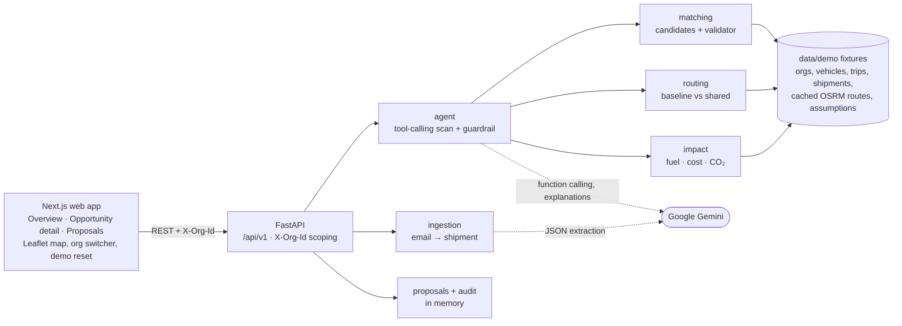

# ShareLoad


Built for the **STEM2Connect AI Hackathon 2026**, **Sustainability** track.

> All organizations, trucks, trips, shipments and emails in this repo are **fictional sample data**. The app shows a "Sample data" badge on every page.

---

## The problem

Trucks often drive home empty after a delivery, while a business nearby pays for a separate truck on the same road. Each company plans only its own fleet, so the shared opportunity is invisible to both of them. The result is extra vehicle-kilometres, fuel, cost and CO₂ that nobody set out to create.

## What ShareLoad does

1. **Detect.** Find pairs of one company's truck trip with spare room and another company's shipment going the same way.
2. **Validate.** Check capacity (weight and volume), cargo temperature, hazardous goods, direction, detour length and pickup/delivery time windows. Every failed check gets a reason code.
3. **Route.** Compare road distance for the baseline (each company drives separately) with the shared plan (one truck carries both).
4. **Quantify.** Calculate distance, fuel, cost and CO₂ for both plans and the difference, with a step-by-step formula trace.
5. **Propose.** Either company can turn a feasible match into a proposal. Only the trip owner or the shipment owner can do this.
6. **Approve.** Both companies must approve. The final state is "Approved for external coordination": ShareLoad records the agreement, and the companies arrange the pickup themselves.

## Demo scenario and results

**NorthStar Regional Freight** (Madison, WI) runs a box truck to a customer in Chicago's West Loop and drives back to Madison **empty**. **Lakeview Supply Co.** (Chicago, IL) needs 6 pallets (1,200 kg, 8 m³) moved from its Chicago warehouse to a customer in Madison the same day, and would otherwise send its own truck there and back.

The scan checks 3 candidates and finds 1 feasible match: NorthStar's return trip picks up Lakeview's load with a **6.1 km** detour.

| | Baseline (separate trucks) | Shared (one truck) | Saved |
| --- | ---: | ---: | ---: |
| Vehicle distance | 944.0 km | 483.0 km | **461.0 km (48.8%)** |
| Fuel | 245.4 L | 125.6 L | **119.9 L** |
| CO₂ (estimate) | 662.7 kg | 339.1 kg | **323.6 kg** |
| Fuel cost | $385.34 | $197.16 | **$188.18** |

The other two candidates are rejected, and the app says why in plain words:

| Candidate | Reason code | Why |
| --- | --- | --- |
| Refrigerated shipment to a grocery co-op | `CARGO_TEMP_UNSUPPORTED` | Needs 2 to 6 °C; NorthStar's truck carries ambient cargo only |
| Same load with a late pickup | `TIME_WINDOW_CONFLICT` | Truck can arrive 11:07–14:07; the pickup window is 15:00–17:00 |

The numbers come straight from the code and fixtures (`data/demo/`, assumptions v2) and are checked by the test suite. The worked example is in [docs/calculation-methodology.md](docs/calculation-methodology.md).

## Screenshots

> Placeholders: add the images to `docs/screenshots/`.

| Overview: agent scan | Opportunity detail: map and checks | Proposals: two-sided approval |
| --- | --- | --- |
|  |  |  |

## How the AI is used

Gemini does three jobs. **Python decides feasibility and does all of the math.**

| Where | What Gemini does | What Python does |
| --- | --- | --- |
| **Agent scan** (`app/agent/`) | Uses function calling to choose which tools to call: `list_candidates`, `validate_candidate`, `evaluate_routes`, `calculate_impact`. Every call is capped, logged and shown in the UI's "Agent tool calls" timeline. | Runs each tool. The opportunities, rejections and every number come from the deterministic scan, so a bad model turn can't change a result. |
| **Explanations** | Writes a one-paragraph scan summary and a short explanation for each opportunity: why it matched or failed, and what could break it. | Gives Gemini only facts taken from tool outputs, then checks its text (see the guardrail below). |
| **Email extraction** (`app/ingestion/`) | Reads a free-text shipment email and fills in the shipment fields, a confidence score and a list of missing fields, using a JSON response schema. | Validates the reply against the Shipment contract. Retries once on bad JSON. Never guesses missing values. |

**Safeguards**

- **Number guardrail.** Every number in Gemini's text must appear in the tool outputs it was given. Any explanation or summary that quotes another number is replaced with a fixed template. The summary must also quote the best match's km, fuel and CO₂ saved exactly.
- **Template fallback.** With no API key, a Gemini error, or a run where Gemini calls no tools, the agent switches to template mode. The tools run in a fixed order and the scan still completes. The UI shows a "Gemini" or "Template" badge.
- **Cached run.** Each successful Gemini scan is saved to `data/demo/last_agent_scan.json` with a fingerprint of the input data. "Use cached result" replays it without calling Gemini, as long as the data hasn't changed. This keeps a live demo reliable.

## Architecture



```
apps/web/                     Next.js + TypeScript + Tailwind + react-leaflet
  app/                        pages: / (Overview), /opportunities/[id], /proposals
  components/                 header, overview, opportunity and proposals components
  lib/api.ts                  API client (NEXT_PUBLIC_API_URL, X-Org-Id)
services/api/
  app/main.py                 FastAPI app and routes
  app/schemas/                Pydantic contracts (strict: extra fields rejected)
  app/matching/               candidate finder, validator with reason codes, scan
  app/routing/                baseline vs shared comparison from cached routes
  app/impact/                 fuel, cost and CO₂ engine with formula trace
  app/agent/                  Gemini config, tools, scan and guardrail
  app/ingestion/              Gemini shipment extraction
  app/proposals/, app/audit/  proposal state machine and audit log (in memory)
  tests/                      pytest suite
data/demo/                    fixtures, routes.geojson, assumptions.json, last_agent_scan.json
docs/PRD.md                   product requirements and build plan
```

## Impact methodology

We compare **total vehicle distance across both businesses** under the same assumptions. The saving comes from Lakeview's truck no longer making its own round trip. NorthStar's return leg is driven in both plans.

- **Baseline** = NorthStar's round trip (outbound + direct return) + Lakeview's own truck Chicago → Madison → Chicago.
- **Shared** = NorthStar's outbound + a return leg that stops at Lakeview's warehouse and the Madison customer. Lakeview's truck does not move.
- **Detour** = shared return leg − direct return leg (6.1 km in the demo; the limit is 30 km).

**Formulas**

- Fuel (L) = km × (L/100 km) ÷ 100
- CO₂ (kg) = fuel (L) × kg CO₂ per litre
- Cost ($) = fuel (L) × price per litre
- Net saved = baseline − shared; % reduction = net distance ÷ baseline distance × 100
- A negative result is shown in a neutral colour as "not recommended".

**Assumptions** (`data/demo/assumptions.json`, version `v2`; sources opened 2026-11-20)

| Assumption | Value | Derived from | Source |
| --- | --- | --- | --- |
| Fuel use | 26 L/100 km | US box-truck average of 9.05 mpg (2021); one rate for loaded and empty running | [U.S. DOE, Fact of the Week #1342](https://www.energy.gov/cmei/vehicles/articles/fotw-1342-may-13-2024-average-road-fuel-economy-mediumheavy-trucks-ranged-40) ([dataset](https://www.energy.gov/sites/default/files/2024-05/FOTW_1342_web.xlsx)), from the 2021 Vehicle Inventory and Use Survey |
| CO₂ per litre | 2.70 kg CO₂/L | Diesel 10.21 kg CO₂/gal, combustion only (tank-to-wheel) | [U.S. EPA, GHG Emission Factors Hub 2025](https://www.epa.gov/system/files/documents/2025-01/ghg-emission-factors-hub-2025.pdf), Table 2 |
| Fuel price | $1.57/L | US on-highway diesel $5.937/gal, week of Nov 16, 2026 | [U.S. EIA, Gasoline and Diesel Fuel Update](https://www.eia.gov/petroleum/gasdiesel/) |
| Max detour | 30 km | Extra distance the carrier's truck may add | Product setting |

Routes are real road distances from OSRM (OpenStreetMap), cached on 2026-11-18.

**Not included:** upstream (well-to-tank) emissions, other greenhouse gases, driver time, tolls, loading and handling, insurance, contract charges, and the difference between loaded and empty fuel use.

The full method, including the system boundary, a worked example and limitations, is in **[docs/calculation-methodology.md](docs/calculation-methodology.md)**.

## Run it locally

You need **Python 3.10+**, **Node.js 20+** and, optionally, a Gemini API key. Without a key everything still works in **template mode**: the scan, explanations and proposals run, and email extraction returns a friendly "not available" message.

### 1. Configure

Create `.env` in the **repo root** (copy `.env.example`):

```
GEMINI_API_KEY=your-key-here
GEMINI_MODEL=gemini-2.5-flash
```

Leave `GEMINI_API_KEY` blank for template mode. `GEMINI_MODEL` is optional and defaults to `gemini-flash-latest`.

Create `apps/web/.env.local`:

```
NEXT_PUBLIC_API_URL=http://127.0.0.1:8000/api/v1
```

> **Windows note:** use `127.0.0.1`, not `localhost`. On Windows, `localhost` can resolve to IPv6 (`::1`) first, while uvicorn listens on IPv4 `127.0.0.1` only, so requests can fail or stall. Without `.env.local`, the web app defaults to `http://localhost:8000/api/v1`.

### 2. Windows (PowerShell)

```powershell
# API: terminal 1
cd services\api
py -m venv .venv
.\.venv\Scripts\Activate.ps1
pip install -r requirements.txt
uvicorn app.main:app --port 8000

# Web: terminal 2
cd apps\web
npm install
npm run dev
```

### 3. macOS / Linux

```bash
# API: terminal 1
cd services/api
python3 -m venv .venv
source .venv/bin/activate
pip install -r requirements.txt
uvicorn app.main:app --port 8000

# Web: terminal 2
cd apps/web
npm install
npm run dev
```

Open <http://localhost:3000>, choose an organization in the header and click **Run scan**. Use **Reset demo** in the header to clear proposals and the audit log.

## API endpoints

Base path `/api/v1`. `X-Org-Id` (`northstar` or `lakeview`) stands in for login. Each org sees only its own trips and shipments and the proposals it is a party to.

| Method | Path | X-Org-Id | Returns |
| --- | --- | --- | --- |
| GET | `/health` | – | `{"status": "ok"}` |
| GET | `/organizations` | – | Both demo organizations |
| GET | `/organizations/{id}/trips` | must match `{id}` | That org's trips |
| GET | `/organizations/{id}/shipments` | must match `{id}` | That org's shipments |
| POST | `/opportunities/scan?use_cached=true\|false` | – | Candidates considered, opportunities, rejected (with reason codes), agent summary, tool calls, mode |
| GET | `/opportunities/{id}` | – | Checks, baseline and shared routes (GeoJSON), impact with formula trace, explanation |
| POST | `/opportunities/{id}/proposals` | required | New proposal (`pending_approvals`). 403 if not a party, 409 if not feasible or already proposed |
| POST | `/proposals/{id}/decision` | required | Updated proposal. Body `{"decision": "approve" or "reject", "comment": "..."}` |
| GET | `/proposals` | required | Proposals the org is a party to |
| GET | `/audit-events` | required | Audit events visible to the org, oldest first |
| POST | `/ingest/shipments/parse` | required | Shipment extracted from `{"raw_text": "..."}`, with confidence and missing fields. 503 without a Gemini key, 502 if Gemini fails |
| POST | `/demo/reset` | – | Clears proposals, audit events and scan caches |

Interactive docs: <http://127.0.0.1:8000/docs>.

## Testing

```bash
cd services/api
python -m pytest -q
```

**141 tests pass** (about 30 s). They don't need a Gemini key or network: Gemini is replaced with fakes.

| Area | What is covered |
| --- | --- |
| Schemas | Strict contracts, timezone-aware windows, check and feasibility consistency |
| Validator | Each reason code, capacity and detour edge cases, missing fields |
| Routing and impact | Baseline vs shared distances, detour, the demo numbers, formula trace, negative savings |
| Scan | 1 feasible and 2 rejected candidates with the expected reasons |
| Agent | Tool-calling loop and call limit, number guardrail, template fallback, cache and stale-data check |
| Agent config and tools | `.env` loading, template mode without a key, tool outputs and logging |
| Ingestion | Extraction to a valid Shipment, missing fields, retry on bad JSON, 502/503 |
| Proposals and audit | Pending → partially approved → approved for external coordination, or rejected; party checks; conflicts; audit trail; demo reset |
| API | Org scoping (403/404/422), CORS, scan, opportunities |

The web app was checked by hand and with scripted browser runs; `npx tsc --noEmit` and `npm run lint` pass. There are no automated frontend tests yet.

## Limitations and honest notes

- **Sample data only.** Two fictional companies, one truck, two trips and three shipments.
- **Cached routes.** Road distances and geometry come from OSRM and were cached on 2026-11-18. Nothing is routed live.
- **No live integrations.** No TMS, telematics, email inbox or payment systems. Extracted shipments are shown, not saved.
- **No dispatch or booking.** ShareLoad stops at "Approved for external coordination". The companies arrange the pickup themselves.
- **Estimates, not measurements.** CO₂ is "potential CO₂ avoided (estimate)", based on a national-average fuel rate used for loaded and empty running, and one week's national diesel price.
- **Demo-grade state and auth.** Proposals and the audit log are in memory and reset when the API restarts. `X-Org-Id` stands in for real authentication.

## What we learned

- _Draft for the team to edit._
- Keeping the language model away from feasibility and arithmetic made the agent easier to trust. Gemini chooses tools and explains results; Python decides and calculates.
- A guardrail that checks every number against the tool outputs, plus a template fallback, is a simple way to stop invented figures from reaching the screen.
- Fair impact numbers depend on choosing the right baseline. The saving is the other company's avoided truck trip, not the carrier's return leg.
- Freezing the API contracts early let the backend and frontend be built in parallel.

## What's next

- Use each truck's own fuel rate and regional fuel prices instead of national averages.
- Live routing and more than one match per truck (multi-stop, partial loads).
- Persistent storage and real sign-in in place of `X-Org-Id`.
- Save extracted shipments directly into the scan, and connect real sources such as a shared inbox or a TMS.

## AI tools disclosure

- **Google Gemini (in the product).** Chooses which matching tools to call during a scan, writes the scan summary and per-opportunity explanations, and extracts shipment fields from free-text emails. It never decides feasibility or produces numbers on its own: see [How the AI is used](#how-the-ai-is-used).
- **Claude Code (development).** Used as a coding assistant to write and test most of the code. The team designed the product, the demo scenario and the API contracts, and reviewed every change.

## Team

| Name | Role |
| --- | --- |
| Kishan Kota | _role_ |
| Hasan | _role_ |
| Stephanie | _role_ |
