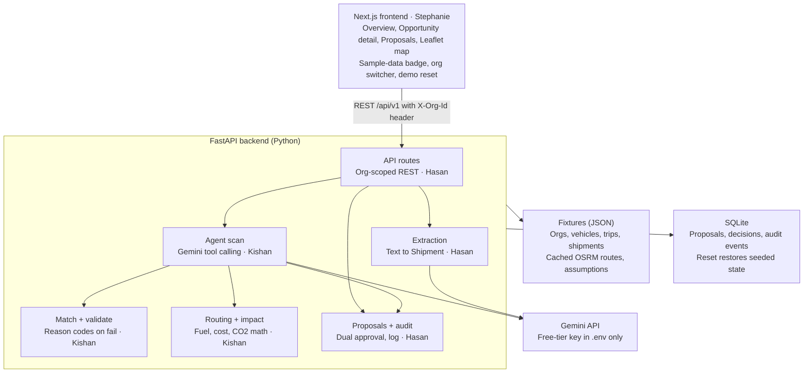

# ShareLoad — PRD & 3-Day Build Plan

Nov 18, 2026 · Kishan Kota, Hasan, Stephanie

## At a glance

We ship one working end-to-end ShareLoad flow (two fictional businesses, one backhaul match, honest impact math, two-sided approval) by **Sat Nov 21, 10:59 PM CT**, and we submit by 8 PM that night, not at the deadline.

| Item | Detail |
| --- | --- |
| Hackathon | STEM2Connect AI Hackathon 2026 (Devpost) |
| Track | Sustainability (choose it in the Devpost form) |
| Hard deadline | Sat Nov 21, 11:59 PM EST = **10:59 PM CT** |
| Our submit target | Working draft Fri 11 PM CT; final by Sat 8 PM CT |
| Demo Day | Tue Nov 24 (live or prerecorded; details in Discord) |
| Team | Kishan (backend: core logic + agent), Hasan (backend: API, data, proposals, deploy), Stephanie (frontend, plus the demo-reset and API-client glue) |
| Must submit | Public GitHub repo + README, demo video of 6 min or less on YouTube/Vimeo, Devpost description, all 3 members joined |
| Judging | 20% each: Problem & Impact, Use of AI, Functionality, Learning & Growth, Presentation |

**The one-line pitch:** ShareLoad is an AI agent that finds unused truck capacity across businesses, checks the match is feasible, and shows the fuel, cost and CO₂ saved before both companies approve.

## Problem, users, promise

Trucks often drive home empty while a business nearby pays for a separate truck on the same corridor. Each company optimizes only its own fleet, so the shared opportunity is invisible.

**Users**

| User | Job | What ShareLoad gives them |
| --- | --- | --- |
| Fleet manager (Business A) | Keep trucks full without hurting service | A compatible backhaul load and its net benefit |
| Shipper / ops coordinator (Business B) | Move goods on time at fair cost | Capacity on a truck already driving that lane |
| Approver at each business | Agree only to safe, sensible deals | Constraints, evidence and impact before committing |

**Product promise:** detect, validate, quantify, propose, approve. The agent never dispatches, books or approves by itself.

**Principles we will not break**

- The LLM extracts and explains. Deterministic Python decides feasibility and does all arithmetic.
- Every number on screen has a baseline, a formula and its assumptions one click away.
- Negative savings are shown honestly; nothing is forced green.
- All data is fictional and labeled "Sample data" in the UI.
- We do not claim to invent load matching; freight marketplaces exist. Our angle is proactive cross-company discovery plus auditable impact plus two-sided approval.

## Locked demo scenario

One Madison ↔ Chicago lane, two fictional businesses, one feasible match and two candidates the system rejects on purpose. Kishan locks the final numbers by Wed midnight; everyone builds against these fixtures.

| Entity | Fixture |
| --- | --- |
| Business A | NorthStar Regional Freight (fictional), Madison-based carrier |
| Vehicle A | Box truck, 4,500 kg payload, 30 m³, ambient only, single fuel rate |
| Trip A | Madison → Chicago delivery, empty return Chicago → Madison; return departs Chicago 11:00–14:00 |
| Business B | Lakeview Supply Co. (fictional), Chicago |
| Shipment B (match) | 1,200 kg, 8 m³, ambient, non-hazardous; pickup 08:00–12:00, deliver Madison 13:00–20:00. Entered as free text and parsed by Gemini |
| Reject 1 | Refrigerated shipment Chicago → Madison: fails `CARGO_TEMP_UNSUPPORTED` |
| Reject 2 | Shipment Chicago → Milwaukee: fails `DETOUR_EXCEEDS_LIMIT` |
| Demo clock | Frozen at the scenario date in config, so nothing shows as expired on Demo Day (Nov 24) |

**Baseline decision (locked):** without ShareLoad, Business B hires a Chicago-based truck that drives Chicago → Madison and back empty. With ShareLoad, B's trip is fully avoided and A adds a small pickup detour in Chicago.

**Working numbers** (approximate; to be replaced with cached OSRM distances and cited factors):

| Scenario | Vehicle-km | Fuel (L) | CO₂ (kg) |
| --- | --- | --- | --- |
| Baseline: A round trip 480 + B round trip 480 | 960 | 278 | 752 |
| Shared: A round trip 480 + 20 km detour | 500 | 145 | 392 |
| **Net saving** | **460 (48%)** | **133** | **360** |

Assumes 29 L/100 km (about 8 mpg box truck) and 2.70 kg CO₂ per litre of diesel. Both must be cited in `docs/calculation-methodology.md` before we show them.

## Scope

We build the demo path end to end and cut everything judges won't see in a 6-minute video.

**Must ship (P0)**

| Feature | Done when | Owner |
| --- | --- | --- |
| Two org workspaces | Switcher shows NorthStar and Lakeview with separate data; API scopes by org | Hasan |
| Fixtures + schemas | Vehicles, trips, shipments load from JSON and validate (Pydantic) | Kishan |
| Gemini shipment extraction | Free text becomes a schema-valid Shipment; missing fields flagged; retry once on bad JSON | Hasan |
| Matching + validator | 1 match passes; 2 candidates fail with reason codes | Kishan |
| Route comparison | Baseline and shared distances + geometry from cached fixtures | Kishan |
| Impact calculator | Distance, fuel, cost, CO₂ for both scenarios with formula trace | Kishan |
| Agent scan | Gemini calls our tools in order; summary uses only tool outputs | Kishan |
| Proposal + dual approval | Draft → pending → partially approved → approved for external coordination / rejected | Hasan |
| Audit trail | Agent tool calls and decisions logged and listed | Hasan |
| Frontend | Overview, Opportunity detail (checklist, map, impact, evidence), Proposals | Stephanie |
| Demo reset | One button/endpoint restores seeded state | Stephanie + Hasan |

**Nice to have (only after Fri noon checkpoint):** edit extracted fields before matching; change fuel rate / detour limit and recalculate; agent activity timeline.

**Cut list (decided, don't reopen)**

- PostgreSQL / PostGIS → SQLite (or in-memory + JSON) for proposals and audit
- OR-Tools → not needed for one pickup and one drop-off
- Live OSRM calls → query once, commit geometry + distances as fixtures labeled "cached OSRM"
- Docker, Data Sources screen, auth → a "Sample data" badge and an org switcher instead
- Real fleet/TMS integrations, ML fuel model, multi-stop optimization

## Architecture and stack

Gemini only extracts and explains; Python decides and calculates.



The agent scan is the only place Gemini drives the flow, and it can only call our Python tools. Every number comes from Match + validate or Routing + impact. Stack: Next.js + TypeScript + Tailwind + Leaflet/OpenStreetMap on the frontend; Python 3.11 + FastAPI + Pydantic + SQLite on the backend. Hosting: one frontend host and one backend host.

**Repo layout**

```
shareload/
  apps/web/                                  # Stephanie
  services/api/app/
    main.py, api/v1/, models/, schemas/      # Hasan
    ingestion/, proposals/, audit/           # Hasan
    matching/, routing/, impact/, agent/     # Kishan
  services/api/tests/                        # owner of the code under test
  data/demo/  organizations.json vehicles.json trips.json shipments.json routes.geojson assumptions.json
  docs/  PRD.md  architecture.md  calculation-methodology.md
  .env.example  README.md
```

## Contracts: data, API, agent tools

These contracts are frozen Wed night so the frontend can build against mock JSON while the backend fills in. Changing one after that needs a message in the team chat.

**Entities** (units: km, kg, m³, litres, ISO-8601 with timezone)

| Entity | Key fields |
| --- | --- |
| Organization | id, name, region, is_sample |
| Vehicle | id, org_id, type, payload_kg, volume_m3, capabilities[], fuel_l_per_100km |
| Trip | id, org_id, vehicle_id, origin, destination, depart_window, arrive_window, distance_km, available_kg, available_m3, leg (outbound/return) |
| Shipment | id, org_id, origin, destination, weight_kg, volume_m3, cargo_type, hazardous, temp_min_c/max_c, pickup_window, delivery_window, raw_text, extraction {confidence, missing_fields} |
| Opportunity | id, trip_id, shipment_id, feasible, reason_codes[], checks[], baseline, shared, impact, score, explanation |
| Proposal | id, opportunity_id, status, version, snapshot, decisions[] |
| AuditEvent | id, org_id, actor (agent/user), event_type, entity, payload, created_at |

Cargo types: ambient, refrigerated, frozen, hazardous, fragile, oversized, other. Proposal status: draft, pending_approvals, partially_approved, approved_for_external_coordination, rejected.

**REST API** (`/api/v1`, header `X-Org-Id` stands in for auth)

| Method + path | Returns | Owner |
| --- | --- | --- |
| GET /organizations | Both demo orgs | Hasan |
| GET /organizations/{id}/vehicles · /trips · /shipments | That org's records only | Hasan |
| POST /ingest/shipments/parse | Shipment + confidence + missing fields | Hasan |
| POST /opportunities/scan | candidates_considered, rejected (with reason codes), opportunities, agent_summary, tool_calls | Kishan |
| GET /opportunities/{id} | Checks, baseline/shared routes (GeoJSON), impact, assumptions, explanation, shared-fields preview | Kishan |
| POST /opportunities/{id}/proposals | Proposal (status pending_approvals) | Hasan |
| POST /proposals/{id}/decision | Updated proposal; body {decision, comment} | Hasan |
| GET /proposals · GET /audit-events | Lists for current org | Hasan |
| POST /demo/reset | Seeded state restored | Hasan (Stephanie wires button) |

**Agent tools** (plain Python functions; Gemini function calling invokes them)

| Tool | Input → output |
| --- | --- |
| find_candidate_matches | trip or shipment id → candidate pairs |
| validate_candidate | trip_id, shipment_id → feasible, checks[], reason_codes[] |
| evaluate_routes | trip_id, shipment_id → baseline + shared distances, detour, geometry |
| calculate_impact | scenarios + assumptions → fuel, cost, CO₂, net, formula trace |
| create_proposal_draft | opportunity_id → draft proposal (never approves) |

Reason codes: `CAPACITY_WEIGHT_EXCEEDED`, `CAPACITY_VOLUME_EXCEEDED`, `CARGO_TEMP_UNSUPPORTED`, `HAZMAT_UNSUPPORTED`, `TIME_WINDOW_CONFLICT`, `DIRECTION_MISMATCH`, `DETOUR_EXCEEDS_LIMIT`, `MISSING_CRITICAL_FIELD`.

**Agent guardrail:** the explanation text may only quote numbers that appear in tool outputs. The code checks this and falls back to a fixed template if Gemini fails or invents a value.

## Impact methodology

We compare total vehicle-km across both businesses under the same assumptions. Savings come from avoiding B's separate round trip, not from A's return leg, which is still driven.

- Fuel (L) = km × (L/100 km) ÷ 100
- CO₂ (kg) = Fuel × 2.70 kg/L (diesel; source to be cited)
- Cost = Fuel × price per litre
- Net saved = Baseline − Shared; % reduction = (Baseline − Shared) ÷ Baseline × 100
- **Baseline** = A's outbound + return, plus B's hired truck Chicago → Madison → Chicago.
- **Shared** = A's outbound + return + pickup/drop-off detour; B's truck movement is zero.
- One fuel rate for loaded and empty (stated as a simplification).
- Excluded: driver time, tolls, handling, insurance, contract charges.
- UI wording: "potential CO₂ avoided (estimate)". Never "measured" or "guaranteed".
- A negative result is shown in neutral color with "not recommended".

**Open items:** cite the diesel CO₂ factor source (EPA) and the box-truck fuel rate source; pick a fuel price and its date; store all of this in `assumptions.json` with a version.

## Who owns what

Kishan owns the logic that makes a match correct, Hasan owns everything that stores and serves it, and Stephanie owns everything a judge sees. Each person owns their folder and reviews PRs touching it.

| | Kishan (backend: intelligence) | Hasan (backend: platform) | Stephanie (frontend + glue) |
| --- | --- | --- | --- |
| Folders | `services/api/app/{matching,routing,impact,agent}`, `data/demo/`, `tests/` | `services/api/app/{main.py,api,models,schemas,ingestion,proposals,audit}`, deploy config | `apps/web/`, demo reset button, API client types |
| Builds | Fixtures and cached routes; candidate finder; validator with reason codes; impact engine; Gemini tool-calling scan; explanation guardrail | FastAPI app and routes; SQLite models; org scoping; Gemini shipment extraction; proposal state machine; audit log; seed/reset; backend deploy | Overview, Opportunity detail (checklist, map, impact, evidence, shared-fields preview), Proposals with two approval cards, Sample-data badge, org switcher; frontend deploy |
| Tests | Capacity edges, cargo/temp, time windows, detour limits, impact formulas, negative-saving case | Proposal transitions (both approve, one rejects, partial); org A can't read org B; bad Gemini JSON retry | Click-through of the full demo script on the deployed site |
| Submission | Methodology doc, "how the agent works" README section, architecture diagram | README setup + env vars, AI disclosure section, deploy links | Demo video (record + edit), screenshots, Devpost description draft |
| Backup for | Hasan's extraction | Kishan's API wiring | Video script review |

**Handoffs that block others**

1. Wed 11:59 PM: Kishan pushes fixtures + Pydantic schemas; Hasan pushes route stubs returning mock JSON. Stephanie builds against those.
2. Thu 6 PM: Kishan's `scan_opportunities()` and `get_opportunity()` work without Gemini; Hasan wires them into the API.
3. Fri noon: real API live on a deployed URL; Stephanie switches off mocks.

**Gemini key:** one free-tier key in `.env` (never committed), shared privately.

## Schedule and checkpoints (all times CT)

| Phase | When | Work | Gate |
| --- | --- | --- | --- |
| 1. Lock contracts | Wed 10 PM–12 AM | Scenario numbers, schemas, mock API, repo, Gemini key | **Contracts frozen · Wed 11:59 PM** — fixtures + schemas pushed; mock routes return JSON |
| 2. Core logic | Thu all day | Match, validate, impact, proposals; UI on mock data | **Works without Gemini · Thu 6 PM** — scan finds 1 match, rejects 2; tests pass |
| 3. AI + integration | Thu 6 PM–Fri noon | Agent tool calling, extraction, API wired, deployed | **Live API deployed · Fri noon** — frontend switches off mocks |
| 4. Full flow + polish | Fri noon–11 PM | Approvals, audit, reset, impact panel, README draft | **Draft on Devpost · Fri 11 PM** — repo public, all 3 joined, track set |
| 5. Ship | Sat 9 AM–8 PM | Code freeze 2 PM, record video, finish README | **Final submit · Sat 8 PM** — hard deadline is 10:59 PM CT |

If a gate slips, we cut from the nice-to-have list first, never from the demo path. Quick sync at each gate (10 min).

**Wed night (now → 11:59 PM)**

- [ ] All: set up the repo, add everyone, read this doc
- [ ] Kishan: lock scenario numbers; query OSRM once for the lane and the Chicago detour; commit `data/demo/*.json`, `routes.geojson`, `assumptions.json`
- [ ] Kishan: Pydantic schemas for Vehicle, Trip, Shipment, Opportunity
- [ ] Hasan: FastAPI skeleton, `/health`, every route returning mock JSON that matches the contracts; get the Gemini key
- [ ] Stephanie: Next.js + Tailwind + Leaflet scaffold, page routes, TS types and a mock data file from the contracts

**Thu (gate: works without Gemini, 6 PM)**

- [ ] Kishan: candidate finder, validator with reason codes, route comparison, impact engine, unit tests
- [ ] Hasan: SQLite models, org scoping, proposal state machine, audit log, seed/reset endpoint
- [ ] Hasan: Gemini extraction endpoint with schema validation and one retry
- [ ] Stephanie: Overview, Opportunity detail (checklist, map with both routes, impact table, methodology panel), Proposals with two approval cards, all on mocks

**Thu 6 PM → Fri noon (gate: live API deployed)**

- [ ] Kishan: Gemini function-calling loop over the tools; explanation guardrail and template fallback; cache last scan for the demo
- [ ] Hasan: wire Kishan's functions into endpoints; CORS; deploy backend
- [ ] Stephanie: deploy frontend; switch to the real API; org switcher and Sample-data badge

**Fri noon → 11 PM (gate: draft on Devpost)**

- [ ] All: run the demo script on the deployed site; log bugs in GitHub issues
- [ ] Kishan: `calculation-methodology.md`, README architecture and agent sections
- [ ] Hasan: README setup, env vars and AI disclosure
- [ ] Stephanie: loading/error states, reset button, screenshots, video script draft
- [ ] Kishan: submit the Devpost draft at 11 PM

**Sat (gate: final submit, 8 PM)**

- [ ] All: bug fixes only until the 2 PM code freeze
- [ ] Stephanie: record the video 2–5 PM (Kishan and Hasan narrate their parts), edit, upload
- [ ] All: final README and Devpost description; submit by 8 PM

## Demo, submission, risks

**Demo video script (target 4:30, hard max 6:00)**

1. 0:00 Hook: "One truck drives home empty while the business next door pays for another truck on the same road."
2. 0:30 NorthStar workspace: the empty return trip. Switch to Lakeview: paste the shipment email; Gemini extracts the fields.
3. 1:15 Run scan: the agent's tool calls appear; 3 candidates considered, 2 rejected with reasons.
4. 2:00 Opportunity detail: constraint checklist, map (baseline vs shared), impact panel, open the methodology.
5. 3:15 Create proposal; approve as NorthStar (partially approved); switch and approve as Lakeview.
6. 4:00 Final status + audit trail. Close with what we learned and what's next.

**Submission checklist**

- [ ] Public GitHub repo with README: problem, solution, setup, env vars, architecture, methodology, limitations
- [ ] AI disclosure in README and Devpost: Gemini (in product) **and every coding assistant we used** (Claude, Copilot, etc.) and what each contributed
- [ ] "All data is fictional sample data; no live integrations" stated in README and UI
- [ ] Demo video under 6 min on YouTube/Vimeo, shows the product working, not slides
- [ ] Devpost form: problem, solution, how we used AI, what we learned, what's next
- [ ] Track = Sustainability
- [ ] Kishan, Hasan and Stephanie all joined the Devpost submission
- [ ] Draft submitted Fri 11 PM CT (.xyz domains are first-come)
- [ ] Final submitted by Sat 8 PM CT
- [ ] Check Discord for Demo Day (Nov 24) slot and prerecord rules

**Risks**

| Risk | Fallback |
| --- | --- |
| Gemini rate limit or bad output during demo | Cached scan result + template explanation; extraction retries once, then manual form |
| Map tiles or routing fail | Geometry is committed as fixtures; map renders offline-safe GeoJSON |
| Deploy breaks Saturday | Record the video from localhost Sat afternoon regardless |
| Judges think "it's just a load board" | Lead with proactive discovery, rejected candidates and visible math |
| Scope creep | Nothing from the nice-to-have list before the Fri noon checkpoint passes |
